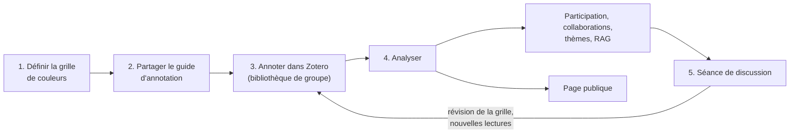
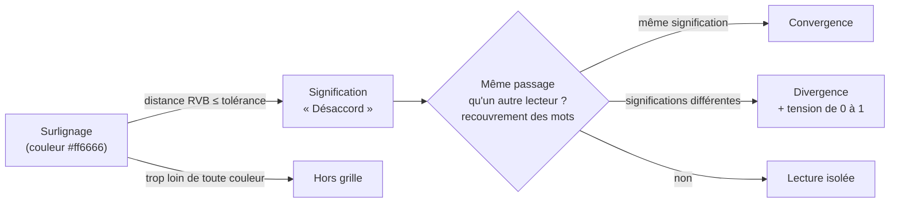
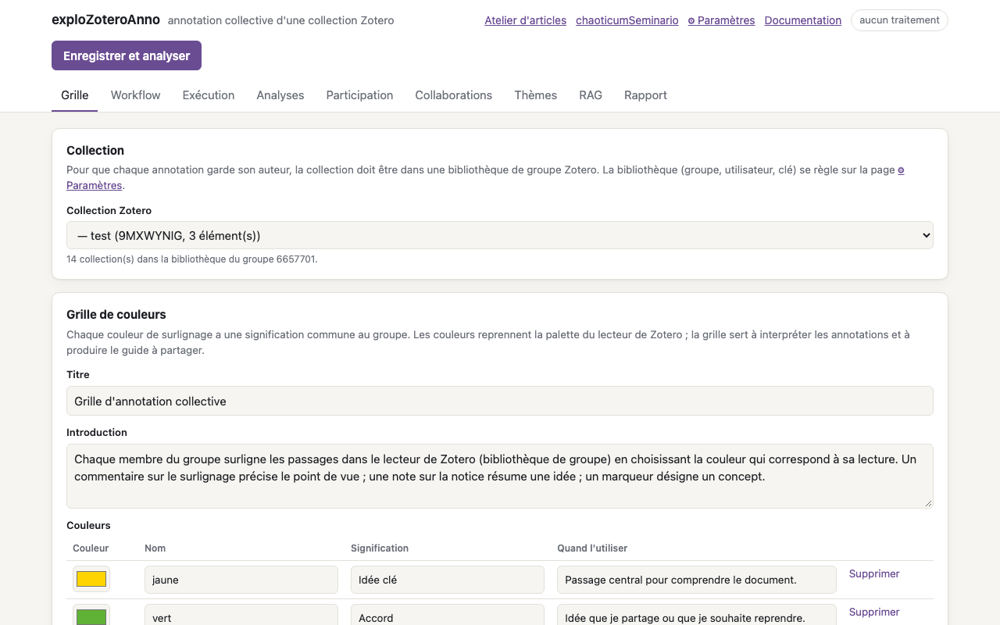
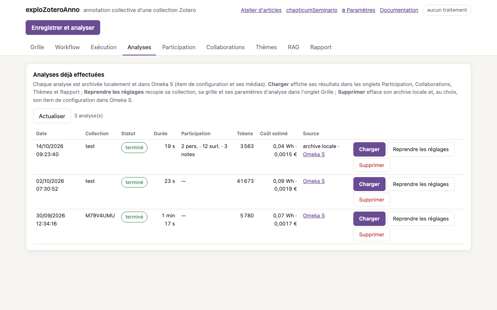
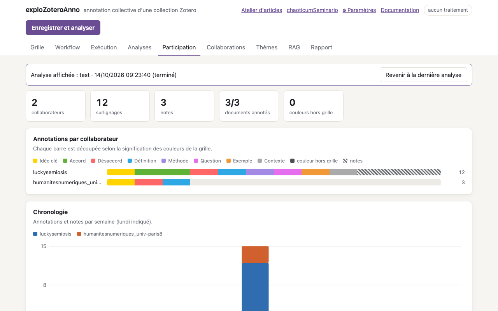
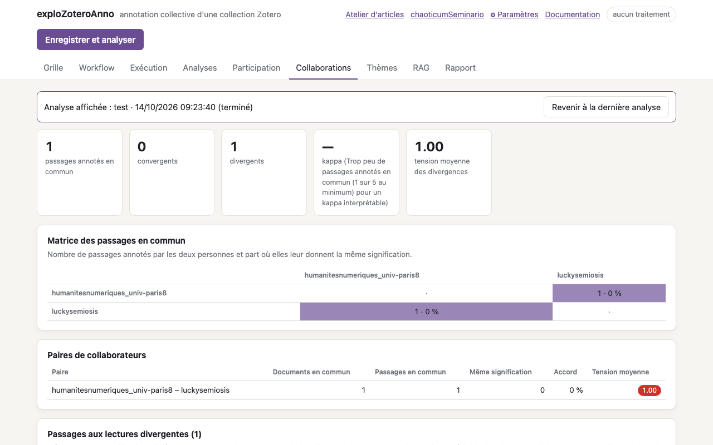
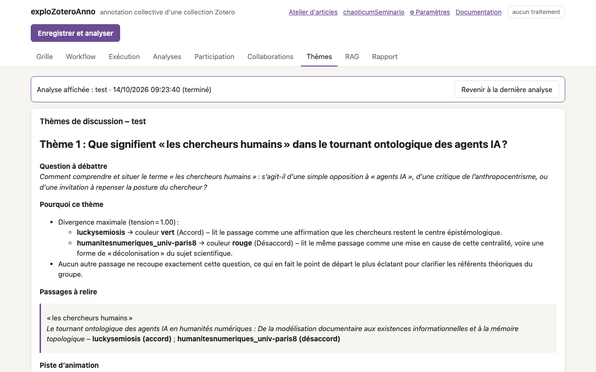
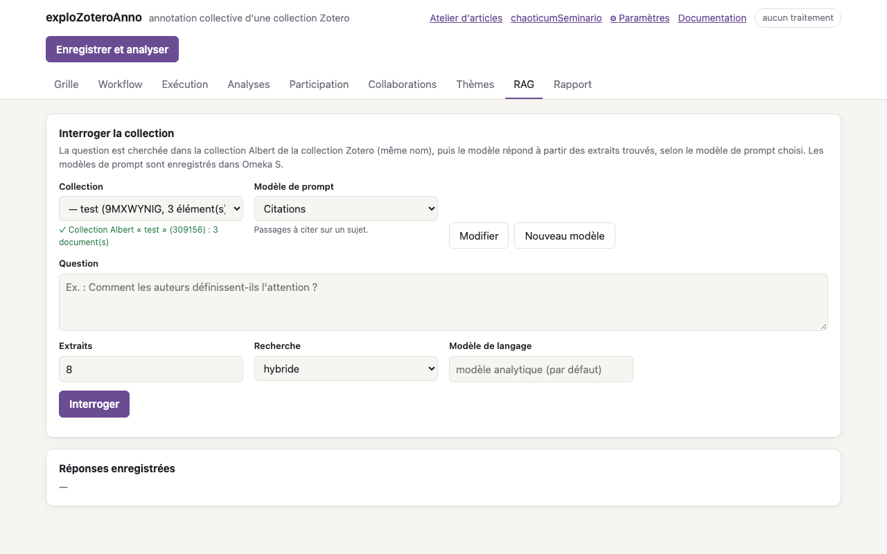
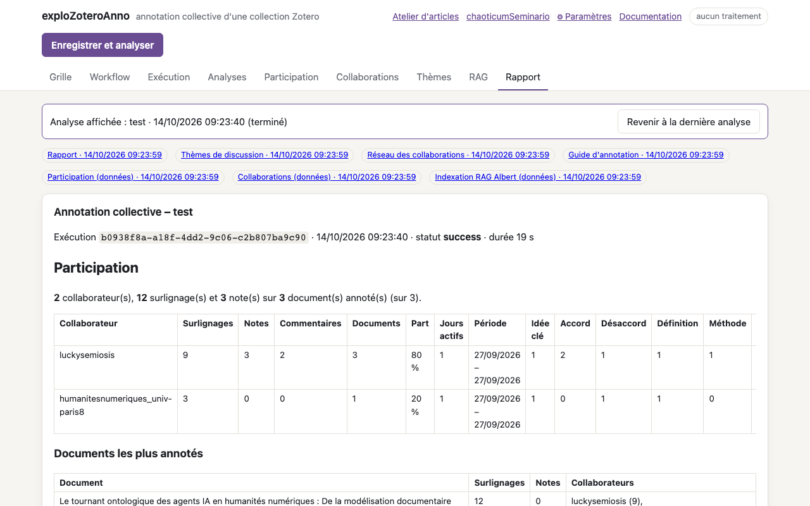

# exploZoteroAnno : guide d'utilisation

**exploZoteroAnno** accompagne un groupe qui lit et annote ensemble une collection Zotero : séminaire, atelier de lecture, équipe de recherche, cours. Chacun surligne les documents dans le lecteur de Zotero avec une couleur dont la **signification est commune au groupe**. L'application lit ces surlignages, mesure la participation, repère les passages où les lectures convergent ou divergent, propose des thèmes de discussion, permet d'interroger la collection (RAG) et archive le tout dans Omeka S. Les résultats peuvent être publiés sur une **page publique** en lecture seule.

Ce guide est consacré à cette seule application. L'installation est décrite dans le [guide d'installation](installation.md) ; les autres applications de l'écosystème dans le [guide utilisateur](utilisateur.md).

| | |
|---|---|
| Adresse | http://127.0.0.1:7273 (serveur propre, `npm run ui:explo`) |
| Page publique | http://127.0.0.1:7273/public/analyses?run=&lt;identifiant&gt; |
| Connexions | page **⚙ Paramètres** de l'application (`.env.explo`, qui complète `.env`) |
| Réglages | onglet **Grille** (enregistrés dans `explo.config.json`) |



## 1. Le protocole d'annotation par couleurs

### Le principe : une couleur, une lecture

Le lecteur de Zotero propose huit couleurs de surlignage. Le protocole leur donne un sens partagé : avant de lire, le groupe adopte une **grille** qui associe à chaque couleur une **signification** et une **consigne** (« quand l'utiliser »). Par défaut :

| Couleur | Signification | Quand l'utiliser |
|---|---|---|
| 🟨 jaune | Idée clé | passage central pour comprendre le document |
| 🟩 vert | Accord | idée que je partage ou que je souhaite reprendre |
| 🟥 rouge | Désaccord | affirmation que je conteste ou qui me pose problème |
| 🟦 bleu | Définition | définition d'un concept ou d'un terme |
| 🟪 violet | Méthode | méthode, protocole ou démarche de recherche |
| 🟣 magenta | Question | point à discuter en groupe, question ouverte |
| 🟧 orange | Exemple | exemple, cas, terrain d'étude |
| ⬜ gris | Contexte | élément de contexte, information secondaire |

Trois gestes complètent la couleur :

- un **commentaire** sur le surlignage précise le point de vue (« d'accord, mais seulement pour… ») ;
- une **note** rattachée à la notice résume une idée ou cite un passage avec son repère (§ 15, p. 12) ;
- un **marqueur** (tag) désigne un concept.

Le surlignage n'est donc pas une simple mise en évidence : c'est une **prise de position codée**, que l'application peut compter et comparer d'un lecteur à l'autre.



L'analyse procède en trois temps :

1. **Rattacher chaque couleur à la grille** : la couleur d'un surlignage est comparée aux couleurs de la grille (distance dans l'espace RVB) ; la plus proche l'emporte si elle est à moins de la **tolérance** (80 par défaut), sinon le surlignage est compté « hors grille ».
2. **Repérer les passages communs** : deux surlignages d'un même document portent sur le même passage quand leurs mots se recouvrent assez (indice de Jaccard, 60 % par défaut).
3. **Comparer les lectures** : sur un passage commun, même signification = **convergence**, significations différentes = **divergence**. Chaque divergence reçoit une **tension**, de 0 (lectures compatibles) à 1 (lectures opposées), et l'accord d'ensemble est mesuré par un **kappa** (Fleiss, et Cohen pour deux personnes).

### La tension entre deux couleurs

Deux lectures différentes ne s'opposent pas toutes autant : « Idée clé » et « Définition » cohabitent, « Accord » et « Désaccord » s'excluent. La tension traduit cet écart. Elle suit d'abord le **rapport entre les deux couleurs sur le cercle chromatique**, chaque rapport ayant une valeur réglable :

| Rapport des couleurs | Écart de teinte | Tension par défaut |
|---|---|---|
| identiques | — | 0 |
| analogues | moins de 45° | 0,2 |
| avec un gris | une couleur peu saturée | 0,3 |
| en carré | autour de 90° | 0,5 |
| triadiques | autour de 120° | 0,75 |
| complémentaires | plus de 150° | 1 |

Une tension peut aussi être **fixée pour une paire de significations**, ce qui l'emporte sur le rapport des couleurs (par défaut : Accord – Désaccord = 1). La tension ordonne les passages divergents (du plus tendu au moins tendu), colore les liens du réseau entre personnes et oriente le choix des thèmes de discussion. Le tableau de l'onglet Grille, repris sur la page publique, montre la tension obtenue entre toutes les significations.

### Ce que le protocole apporte

- **Un geste léger, au fil de la lecture.** Surligner en couleur est un geste que chacun fait déjà : pas d'outil de codage à apprendre, pas de formulaire. L'annotation se fait dans le lecteur de Zotero, sur ordinateur, tablette ou téléphone, à son rythme.
- **Une lecture rendue visible et discutable.** La couleur dit *comment* on lit, pas seulement *ce qu'on* retient. Les lectures de chacun deviennent comparables et la discussion part de passages précis plutôt que d'impressions générales.
- **La divergence comme matériau.** Le protocole ne cherche pas à faire converger : un passage lu « Accord » par l'un et « Désaccord » par l'autre est un excellent point de départ pour une séance. Les thèmes de discussion sont construits à partir de ces écarts.
- **Une gradation plutôt qu'un oui/non.** La tension distingue les divergences anodines (deux teintes voisines) des oppositions franches, et chaque groupe peut l'ajuster à sa grille.
- **Une mesure de l'accord.** Le kappa indique si la grille est comprise de la même façon par tous : un accord faible sur des passages communs signale souvent une consigne ambiguë plus qu'un désaccord de fond.
- **Une participation observable.** Qui annote quoi, quand, avec quelles couleurs : l'animateur voit les documents délaissés et les personnes à solliciter, et peut ajuster la répartition des lectures.
- **Un dispositif itératif et traçable.** La grille se révise entre deux séances ; chaque analyse archive la grille en vigueur, ses réglages et ses résultats (archive locale et Omeka S), ce qui permet de suivre l'évolution d'une campagne et de rendre compte de la méthode.

### Les limites de la démarche

Le protocole est un **outil d'animation et d'exploration**, pas un instrument de codage qualitatif rigoureux. Ses limites tiennent à la couleur elle-même, à la grille, aux calculs et à l'usage des résultats.

**Ce que la couleur ne peut pas dire**

- **Une seule signification par surlignage.** Un passage qui est à la fois une définition et un point de désaccord doit être réduit à l'une des deux. Le commentaire permet de nuancer, mais l'analyse ne compte que la couleur.
- **Huit couleurs au plus.** La palette de Zotero limite la grille à quelques catégories larges. Un codage fin (sous-catégories, codes argumentatifs) relève des **marqueurs**, comme dans le codebook de l'Atelier d'articles, pas des couleurs.
- **Le choix de ce qu'on surligne échappe à la mesure.** Chacun décide quoi surligner. Ne pas surligner un passage n'est ni un accord ni un désaccord : les comparaisons ne portent que sur ce que deux personnes ont *toutes deux* choisi de marquer.
- **Les habitudes personnelles résistent.** Beaucoup de lecteurs ont déjà leur propre code couleur (jaune pour « important », par exemple). Sans rappel régulier, l'ancien code revient et brouille l'analyse.

**Ce que la grille peut mélanger**

- **Des axes hétérogènes.** La grille par défaut mélange trois questions : *l'importance* (Idée clé, Contexte), *la posture* (Accord, Désaccord, Question) et *le type de contenu* (Définition, Méthode, Exemple). Deux personnes qui surlignent le même passage en « Idée clé » et en « Définition » ne sont pas en désaccord : elles répondent à des questions différentes. L'analyse compte pourtant une divergence.
- **Une grille qui change en cours de campagne.** Modifier une signification entre deux analyses rend leurs résultats difficilement comparables ; les surlignages déjà faits gardent leur couleur, mais pas leur sens d'origine. La page publique affiche, pour cette raison, la grille **de chaque analyse**.

**Ce que les calculs approximent**

- **La tension chromatique est une convention, pas une propriété du sens.** Les couleurs de Zotero n'ont pas été choisies pour leurs rapports sémantiques. Avec la grille par défaut, jaune (Idée clé) et violet (Méthode) sont presque complémentaires sur le cercle : leur tension vaut 1, comme Accord – Désaccord, alors que ces lectures sont parfaitement compatibles. Le cercle chromatique est un point de départ : il faut **fixer les tensions des paires** qui comptent et vérifier le tableau des tensions avant de lancer une campagne.
- **Le rattachement des couleurs dépend de la tolérance.** Une couleur personnalisée ou un surlignage fait dans un autre lecteur PDF peut tomber « hors grille » ou être rattaché à la mauvaise signification. Le nombre de couleurs hors grille, dans l'onglet Participation, est à surveiller.
- **Le repérage des passages communs est approximatif.** Deux personnes qui surlignent l'une une phrase, l'autre tout le paragraphe, ne se recouvrent pas assez pour être rapprochées : les passages communs sont plutôt sous-estimés. Abaisser la similarité les rapproche davantage, au risque de rapprocher des passages distincts.
- **Le kappa demande des données.** En dessous du minimum de passages communs (5 par défaut), il n'est pas calculé. Au-dessus, il reste sensible à la répartition des catégories (une couleur très majoritaire tire l'accord vers le bas) et il ne porte que sur les passages choisis par les lecteurs, pas sur des unités imposées. Voir l'[annexe sur les kappas](#annexe-comprendre-les-kappas).

**Ce que les résultats ne doivent pas devenir**

- **La couleur n'est pas perçue par tous de la même façon.** Le rouge et le vert, cœur de la grille par défaut (Désaccord, Accord), sont les couleurs que confondent le plus souvent les personnes daltoniennes. Le guide d'annotation doit donner le **nom** des couleurs, et la grille éviter de reposer sur une seule paire rouge/vert.
- **Compter n'est pas évaluer.** Le nombre de surlignages mesure une activité visible, pas la qualité d'une lecture : une personne qui annote peu mais commente finement contribue autant qu'une autre. Utiliser les chiffres de participation pour noter ou classer des personnes détourne le dispositif et pousse à surligner pour être vu.
- **Les annotations sont nominatives.** Les résultats montrent qui a lu quoi et comment, avec des citations et des commentaires. Avant de publier une analyse (section 4), le groupe doit en être informé et d'accord.
- **Les thèmes et les réponses RAG sont produits par un modèle de langage.** Ce sont des propositions à vérifier dans les passages cités, pas des synthèses faisant autorité.

### Bonnes pratiques

1. **Construire la grille avec le groupe**, et pour un but précis (préparer une discussion, repérer des concepts, comparer des positions). Une grille courte, comprise de tous, vaut mieux qu'une grille complète.
2. **Choisir un axe principal.** Par exemple une grille de *posture* : Accord (vert), Nuance (jaune), Désaccord (rouge), Question (magenta), Contexte (gris). Les types de contenu (définition, méthode, exemple) passent alors par des marqueurs. Si les axes restent mélangés, fixer à 0 la tension entre significations compatibles.
3. **Vérifier le tableau des tensions** dans l'onglet Grille et fixer les paires dont le rapport de couleurs ne reflète pas le sens.
4. **Calibrer avant de lancer.** Faire annoter le même court document par tous, lancer une analyse, regarder les divergences et le kappa, puis préciser les consignes là où les lectures divergent pour des raisons de compréhension de la grille.
5. **Demander un commentaire** pour les couleurs qui engagent (Désaccord, Question) : c'est lui qui nourrit la discussion.
6. **Partager le guide d'annotation** produit par l'application (avec le nom des couleurs) et le rappeler à chaque séance.
7. **Ne pas modifier la grille en cours de campagne** ; si c'est nécessaire, lancer une analyse juste avant, pour garder une trace de l'état précédent.
8. **Relancer l'analyse régulièrement** (avant chaque séance) : les nouvelles annotations sont prises en compte sans réextraire les documents déjà enregistrés, et les analyses successives montrent l'évolution du groupe.
9. **Présenter les résultats comme un support de discussion**, jamais comme une évaluation individuelle.

## 2. Préparer une campagne d'annotation

### Bibliothèque de groupe et collection

- Créer (ou réutiliser) une **bibliothèque de groupe** Zotero et y inviter les participants : c'est ce qui permet de savoir qui a fait chaque annotation. Dans une bibliothèque personnelle, toutes les annotations sont attribuées à « (non attribué) ».
- Rassembler les documents à lire dans une **collection** (PDF, EPUB, pages web enregistrées…). Si plusieurs personnes ajoutent le même document, l'application détecte les doublons (même fichier, DOI, URL, ou titre et année) et cumule leurs annotations sur un seul document.
- Sur la page **⚙ Paramètres** : clé et identifiant du groupe Zotero, clé de l'API Albert, connexion Omeka S. **Tester les connexions** vérifie chacune.

### Régler la grille (onglet Grille)



- **Collection** : la collection annotée (la liste suit la bibliothèque enregistrée dans les Paramètres).
- **Grille de couleurs** : titre, introduction, puis pour chaque couleur son nom, sa signification et sa consigne. Couleurs, libellés et nombre de lignes se modifient librement.
- **Tolérance de couleur** : écart accepté (distance RVB) pour rattacher un surlignage à une couleur de la grille.
- **Tension entre les couleurs** : valeur de chaque rapport de couleurs, tensions fixées par paire de significations, tableau des tensions obtenues.
- **RAG Albert** : indexation des documents dans Albert à chaque analyse, taille des extraits, réglages de recherche par défaut.
- **Analyse** : similarité de passage, libellé des annotations sans auteur, fusion des doublons, minimum de passages communs pour le kappa, nombre de thèmes, nombre de passages transmis à l'agent des thèmes.
- **Guide d'annotation à partager** : aperçu du guide produit à partir de la grille, à **copier** ou **télécharger** (markdown) pour l'envoyer au groupe ; il est aussi enregistré dans Omeka S à chaque analyse.

**Enregistrer** garde les réglages ; **Rétablir la grille par défaut** remet les couleurs d'origine (la collection est conservée).

### Lancer et suivre une analyse

**Enregistrer et analyser** lance le traitement ; l'onglet **Exécution** affiche son journal en direct, **Arrêter** l'interrompt. Une analyse lit les documents et leurs annotations, les enregistre dans Omeka S, calcule participation et collaborations, indexe les textes dans Albert puis demande à un agent des thèmes de discussion. Elle peut être relancée à tout moment : les documents déjà enregistrés ne sont pas réextraits.

L'onglet **Workflow** montre les étapes et les agents ; un clic sur un agent permet de lire et modifier ses instructions et son modèle.

## 3. Lire les résultats

### Analyses



Toutes les analyses effectuées, de l'archive locale et d'Omeka S : date, collection, statut, durée, participation, tokens, coût estimé.

- **Charger** affiche ses résultats dans les onglets suivants (un bandeau rappelle l'analyse affichée) ;
- **Reprendre les réglages** recopie sa collection, sa grille et ses paramètres dans l'onglet Grille ;
- **Supprimer** efface son archive locale et, au choix, son item de configuration dans Omeka S ;
- **Page publique ↗** ouvre ses résultats sur la page publique, à l'adresse à partager (section 4).

### Participation



Chiffres clés (collaborateurs, surlignages, notes, documents annotés, couleurs hors grille, doublons fusionnés), une barre par personne découpée selon les significations de la grille, la chronologie par semaine, le détail par personne et la couverture de la collection (qui a annoté quel document).

*À lire* : un nombre élevé de couleurs hors grille signale des habitudes personnelles ou une tolérance trop faible ; des documents sans annotation, une répartition à revoir. La barre d'une personne montre sa façon de lire (beaucoup de questions, peu d'accords…), pas sa valeur.

### Collaborations



Passages annotés en commun, convergents et divergents, kappa, tension moyenne ; matrice des passages communs et de l'accord par paire ; passages divergents du plus tendu au moins tendu, avec la lecture et le commentaire de chacun ; passages convergents ; réseau collaborateurs–documents (glisser, survoler, cliquer ; couleur des liens entre personnes = tension).

*À lire* : les passages divergents les plus tendus sont les meilleurs points de départ d'une discussion. Le kappa est expliqué en [annexe](#annexe-comprendre-les-kappas). Un kappa faible avec beaucoup de divergences de faible tension indique plutôt une grille comprise différemment qu'un désaccord de fond (voir les limites).

### Thèmes



Un agent propose des thèmes pour une séance : pour chacun, une question ouverte, la raison du choix, les passages à relire et les personnes concernées, une piste d'animation. Il veille à impliquer les participants les moins actifs. Ce sont des propositions, à reprendre ou écarter.

### RAG



Le texte des documents est déposé dans une collection privée d'Albert portant le nom de la collection Zotero. Une question y est cherchée (recherche hybride, sémantique ou lexicale), puis un modèle répond à partir des seuls extraits trouvés, en les citant `[n]`, selon un **modèle de prompt** enregistré dans Omeka S (Synthèse, Définitions, Questions de discussion, Citations, ou modèles du groupe). Le coût de chaque consultation s'affiche ; une réponse utile peut être **enregistrée dans Omeka S**, elle apparaît alors dans les réponses enregistrées de la collection, et sur la page publique.

### Rapport



Le rapport reprend participation, collaborations, thèmes, indexation RAG, tokens consommés et coût estimé (énergie, carbone, équivalent API). Les fichiers produits (guide, réseau, données JSON) se téléchargent depuis cet onglet. Tout est enregistré dans Omeka S : un item de configuration par analyse, avec ses médias.

## 4. Publier les résultats : la page publique

Chaque analyse réussie peut être consultée **sans connexion et en lecture seule** sur une page dédiée :

```
http://127.0.0.1:7273/public/analyses?run=<identifiant de l'analyse>
```

En ligne, l'adresse publique de l'application remplace `http://127.0.0.1:7273` (par exemple `https://explo.example.org/public/analyses?run=…`). Le lien d'une analyse s'obtient par **Page publique ↗** dans l'onglet Analyses de l'application, ou par **Copier le lien** sur la page publique elle-même.

La page a six onglets :

| Onglet | Contenu |
|---|---|
| **Analyses** | liste des analyses publiées ; pour l'analyse choisie : collection (avec un **lien vers la collection sur zotero.org** et sa visibilité : consultable par tous, ou réservée aux membres du groupe), date, durée, participation, réglages (similarité de passage, seuil du kappa), coût énergétique estimé, puis **la grille de couleurs utilisée pour cette analyse** (couleurs, significations, consignes, tolérance) et le **tableau des tensions** entre ses significations |
| **Participation** | comme dans l'application |
| **Collaborations** | comme dans l'application, réseau compris (sans lien vers l'administration d'Omeka S) |
| **Thèmes** | thèmes de discussion de l'analyse |
| **RAG** | **interroger la collection** de l'analyse : choisir un type de réponse (modèles de prompt d'Omeka S : Synthèse, Définitions, Questions de discussion, Citations…), poser une question, lire la réponse citée `[n]` et les extraits utilisés, avec son coût estimé ; puis le bilan d'indexation dans Albert et les **réponses enregistrées** depuis l'application |
| **Rapport** | rapport de l'analyse et fichiers produits à télécharger |

L'adresse garde l'analyse et l'onglet affichés (`?run=…&onglet=collab`, `participation`, `themes`, `rag`, `report`) : un lien peut ouvrir directement les passages divergents d'une analyse. Sans identifiant, la page affiche l'analyse la plus récente.

**Questions posées depuis la page publique** : elles portent toujours sur la collection de l'analyse affichée, avec le modèle de langage de l'assistant RAG (onglet Workflow de l'application) et les réglages de recherche de l'application, que le visiteur ne peut pas changer. Les réponses ne sont pas enregistrées dans Omeka S (l'enregistrement reste réservé à l'application). Chaque question consomme des ressources Albert : elles sont limitées par visiteur et par jour (réglages ci-dessous) ; au-delà, la page affiche le délai avant de pouvoir reposer une question. Les quotas sont tenus en mémoire et repartent de zéro au redémarrage du serveur.

**Ce qui n'est pas publié** : les connexions et réglages de l'application, la consommation détaillée en tokens et le coût en argent, les liens vers l'administration d'Omeka S, les analyses en échec. La page demande aux moteurs de recherche de ne pas l'indexer (`noindex`).

**Réglages** (fichier `explo.config.json`, rubrique `public`) :

| Clé | Par défaut | Effet |
|---|---|---|
| `enabled` | `true` | `false` : la page publique et ses routes répondent 404 |
| `listRuns` | `true` | `false` : la liste des analyses n'est pas affichée ; une analyse ne s'ouvre que par son lien (identifiant dans l'adresse) |
| `ragAnswers` | `true` | `false` : les réponses RAG enregistrées ne sont pas montrées |
| `ragQuery` | `true` | `false` : pas de question à la collection depuis la page publique |
| `ragPerHour` | `10` | questions par heure et par visiteur (adresse IP) |
| `ragPerDay` | `200` | questions par jour pour l'ensemble des visiteurs |
| `ragMaxQuestion` | `1000` | longueur maximale d'une question (caractères) |

```json
{ "public": { "listRuns": false } }
```

**Mise en ligne** : derrière Apache, l'application est protégée par mot de passe ; il faut exempter `/public/` de cette protection pour que la page soit accessible à tous (voir le [guide d'installation](installation.md), section du proxy) et renseigner `EXPLO_URL` pour que les liens partagés contiennent l'adresse publique.

> ⚠️ La page publique montre le nom des collaborateurs, leurs surlignages, leurs commentaires et des extraits des documents. Avant de partager un lien, s'assurer que le groupe est d'accord et que la diffusion des extraits est compatible avec les droits des documents. Avec `listRuns: false`, seules les personnes qui ont reçu le lien d'une analyse peuvent la consulter (l'identifiant est difficile à deviner, mais il ne s'agit pas d'une protection par mot de passe).

## 5. Questions fréquentes

**Toutes les annotations sont attribuées à « (non attribué) ».** La collection est dans une bibliothèque personnelle, ou l'identifiant du groupe n'est pas renseigné dans les Paramètres.

**Beaucoup de couleurs « hors grille ».** Des surlignages ont été faits avec une couleur personnalisée ou dans un autre lecteur PDF. Augmenter la tolérance, ou ajouter la couleur à la grille.

**Le kappa n'est pas calculé.** Trop peu de passages annotés en commun : demander de lire les mêmes documents, ou abaisser le minimum (au risque d'un kappa peu interprétable).

**Deux lectures compatibles apparaissent très « tendues ».** Leurs couleurs sont éloignées sur le cercle chromatique. Fixer la tension de cette paire de significations dans l'onglet Grille (par exemple 0), puis relancer l'analyse.

**J'ai modifié la grille : les anciennes analyses ont-elles changé ?** Non. Chaque analyse garde la grille en vigueur au moment où elle a été lancée ; la page publique l'affiche dans l'onglet Analyses.

**La page publique demande un mot de passe.** Le proxy protège aussi `/public/` : ajouter l'exception décrite dans le guide d'installation.

**La page publique répond « Analyse introuvable ».** L'analyse a été supprimée, a échoué, ou l'identifiant du lien est incomplet.

## Annexe : comprendre les kappas

L'onglet **Collaborations** et le rapport donnent un **kappa** : un indice d'accord entre lecteurs sur la signification des couleurs. Cette annexe explique ce qu'il mesure, comment il est calculé dans exploZoteroAnno et comment le lire, ou ne pas le lire.

### Pourquoi ne pas se contenter d'un pourcentage d'accord ?

Le plus simple serait de compter la part des passages communs où deux personnes ont choisi la même couleur. C'est ce que montrent la colonne **Accord** des paires de collaborateurs et la matrice des passages communs. Mais une part de cet accord est due au **hasard** : si deux lecteurs surlignent presque tout en vert, ils tomberont souvent d'accord sans s'être compris pour autant.

Le kappa corrige le pourcentage d'accord de cet accord attendu par hasard :

```
kappa = (accord observé − accord attendu par hasard) / (1 − accord attendu par hasard)
```

- **1** : accord parfait ;
- **0** : pas plus d'accord que si chacun avait choisi ses couleurs au hasard, en gardant ses habitudes (ses proportions de couleurs) ;
- **valeur négative** : moins d'accord que le hasard, signe d'un désaccord systématique ou de catégories comprises à l'inverse.

### Les deux kappas calculés

- **Kappa de Cohen** (1960) : accord entre **deux** personnes. L'accord attendu par hasard tient compte des habitudes de *chacune* : si Alice met 50 % de vert et Bob 40 %, la probabilité qu'ils choisissent tous les deux le vert par hasard est 0,5 × 0,4 = 0,2. exploZoteroAnno ne le calcule que lorsque l'analyse compte exactement deux collaborateurs.
- **Kappa de Fleiss** (1971) : accord entre **deux personnes ou plus**, toujours calculé. Pour chaque passage, il mesure la part des paires de lecteurs qui ont choisi la même couleur ; l'accord attendu par hasard repose sur la répartition des couleurs **de l'ensemble du groupe**. Il admet que les passages n'ont pas tous le même nombre de lecteurs, ce qui est le cas dans une annotation libre.

Avec deux personnes, les deux valeurs sont proches mais peuvent tomber de part et d'autre d'un seuil d'interprétation : l'onglet Collaborations et le rapport affichent alors les deux kappas, chacun avec sa propre interprétation.

### Comment exploZoteroAnno le calcule

1. Les surlignages de personnes différentes sont regroupés en **passages communs** (mots en commun au-delà du seuil de *similarité de passage*, 60 % par défaut).
2. Chaque surlignage est rattaché à une **signification de la grille** ; les couleurs **hors grille** ne comptent pas.
3. Seuls les passages lus par **au moins deux personnes** avec une couleur de la grille entrent dans le calcul.
4. En dessous du **minimum de passages communs** (5 par défaut, réglage *Passages communs minimum pour le kappa*), le kappa n'est pas calculé : l'onglet affiche « — » et le nombre de passages manquants.
5. Le kappa est interprété avec l'échelle de Landis et Koch (1977) :

| Kappa | Interprétation affichée |
|---|---|
| 0 ou moins | aucun accord (pas mieux que le hasard) |
| 0,01 à 0,20 | accord léger |
| 0,21 à 0,40 | accord passable |
| 0,41 à 0,60 | accord modéré |
| 0,61 à 0,80 | accord substantiel |
| 0,81 à 1 | accord presque parfait |

Ces seuils sont une convention, pas une norme statistique. Pour constituer un corpus d'entraînement, on vise souvent au moins 0,61. Pour une grille de discussion, un accord modéré est déjà utile, et un accord trop élevé peut même signifier que la grille ne laisse pas de place aux lectures divergentes.

### Exemple : deux lecteurs, dix passages

Alice et Bob ont surligné les mêmes dix passages avec trois couleurs : vert (Accord), rouge (Désaccord) et magenta (Question).

| | Bob : Accord | Bob : Désaccord | Bob : Question | Total Alice |
|---|---|---|---|---|
| **Alice : Accord** | **4** | 1 | 0 | 5 |
| **Alice : Désaccord** | 0 | **2** | 1 | 3 |
| **Alice : Question** | 0 | 1 | **1** | 2 |
| **Total Bob** | 4 | 4 | 2 | 10 |

- Accord observé : (4 + 2 + 1) / 10 = **0,70**.
- Accord attendu par hasard (Cohen) : 0,5 × 0,4 + 0,3 × 0,4 + 0,2 × 0,2 = **0,36**.
- Kappa de Cohen : (0,70 − 0,36) / (1 − 0,36) = **0,53**, accord modéré.
- Kappa de Fleiss : l'accord attendu repose sur les couleurs des deux lecteurs réunis (9 Accord, 7 Désaccord, 4 Question sur 20) : 0,45² + 0,35² + 0,20² = 0,365, d'où (0,70 − 0,365) / (1 − 0,365) = **0,53**.

70 % d'accord brut ne correspond qu'à un kappa de 0,53 : une partie de cet accord serait obtenue par hasard.

### Le piège des couleurs très majoritaires

Sur dix autres passages, Alice et Bob mettent presque tout en vert. Ils sont d'accord sur 8 passages (Accord), puis chacun met une fois Désaccord là où l'autre a mis Accord.

- Accord observé : **0,80**.
- Chacun a 9 Accord et 1 Désaccord : accord attendu par hasard 0,9 × 0,9 + 0,1 × 0,1 = **0,82**.
- Kappa : (0,80 − 0,82) / (1 − 0,82) = **−0,11**, aucun accord.

80 % d'accord et un kappa négatif : quand une couleur domine, le hasard suffit à expliquer l'accord, et les rares désaccords portent justement sur les passages qui comptent. C'est le **paradoxe du kappa**. Il faut toujours lire le kappa avec la répartition des couleurs (onglet Participation) et les passages divergents.

### Plus de deux lecteurs

Pour un passage lu par trois personnes, dont deux mettent Accord et une Désaccord, Fleiss compte les paires de lecteurs : sur les 3 paires possibles, 1 seule est d'accord. L'accord sur ce passage vaut donc 1/3. Le kappa de Fleiss fait la moyenne de ces accords sur tous les passages communs et la compare à l'accord attendu d'après les couleurs de tout le groupe.

### Ce que le kappa ne dit pas

- **Il ne porte que sur les passages choisis.** Dans exploZoteroAnno, chacun décide quoi surligner. Le kappa ne mesure l'accord que sur les passages que plusieurs personnes ont *toutes* surlignés : il ne dit rien des passages qu'une seule a remarqués.
- **Il traite toutes les divergences de la même façon.** Mettre « Idée clé » au lieu de « Définition » compte autant que mettre « Désaccord » au lieu d'« Accord ». La **tension** sert à graduer ces divergences.
- **Il dépend du découpage des passages.** Changer la *similarité de passage* change les passages communs, donc le kappa. Deux analyses ne sont comparables qu'avec les mêmes réglages et la même grille.
- **Il est instable avec peu de passages.** Avec 5 à 10 passages communs, un seul passage peut faire varier le kappa de plusieurs dixièmes. Le minimum de passages évite les valeurs absurdes, il ne les rend pas précises.
- **Il ne juge pas les personnes.** Un kappa faible signale le plus souvent une grille comprise de façons différentes (consignes ambiguës, axes mélangés). C'est un signal pour **améliorer la grille** ou en discuter, pas pour désigner un « mauvais » lecteur.

### Que faire d'un kappa faible ?

1. Regarder les **passages divergents** : les mêmes couples de significations reviennent-ils (Idée clé / Définition, Accord / Question…) ?
2. Si oui, préciser les **consignes** de ces couleurs ou les fusionner, ou fixer leur tension à 0 si leurs lectures sont compatibles.
3. Faire une courte **séance de calibration** sur un document commun, puis relancer l'analyse et comparer les kappas.
4. Si les divergences portent sur le fond (Accord / Désaccord), le kappa faible est un **résultat** : ce sont les sujets de la prochaine discussion.

*Références :* J. Cohen, « A coefficient of agreement for nominal scales », *Educational and Psychological Measurement*, 1960. J. L. Fleiss, « Measuring nominal scale agreement among many raters », *Psychological Bulletin*, 1971. J. R. Landis et G. G. Koch, « The measurement of observer agreement for categorical data », *Biometrics*, 1977.
